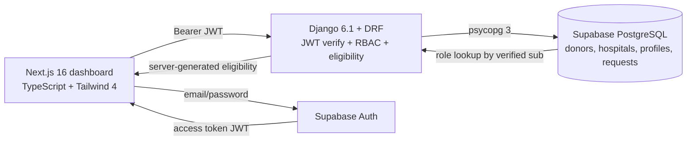

# Blood Donor Registry System

A full-stack donor registry that lets administrators manage donors and hospitals, and lets
hospital staff search donors, create blood requests and view analytics. Supabase
PostgreSQL/Auth backs a Django REST Framework API, which a Next.js App Router dashboard
consumes.

> **Status:** Phases 1–7 are complete and locally verified. Database assertions, 64 Django
> tests, 11 frontend tests, lint, type-check and production build all pass. See
> [`docs/DEVELOPMENT_PLAN.md`](docs/DEVELOPMENT_PLAN.md) for the phase-by-phase checklist.

> **Clinical disclaimer:** the 90-day rule is a classroom **registry screening** rule, not
> a medical eligibility assessment. Clinical screening and national guidelines still apply.

## Architecture



Trust boundaries:

- The browser never receives a service-role key or database credentials.
- Django verifies JWT signature, expiry, issuer and audience, then reads the role from
  `public.profiles` using the token's `sub` claim. JWT role claims and request-body roles
  are ignored.
- Hospital accounts only see requests for their own `hospital_id`; ineligible donors have
  their phone number hidden from hospital staff.
- The 90-day eligibility rule lives only in `backend/donors/services.py`. The frontend
  displays the server's `eligible`, `days_until_eligible` and `eligibility_badge` values.
- SQL migrations own the domain schema; Django models use `managed = False`.

See [`docs/ARCHITECTURE.md`](docs/ARCHITECTURE.md) for the ERD and request sequence diagram.

## Technology stack

| Layer | Technologies |
|---|---|
| Database | Supabase PostgreSQL, SQL migrations, RLS, seed data |
| API | Python 3.14, Django 6.1.3, DRF 3.18.3, PyJWT, psycopg 3 |
| Frontend | Next.js 16.4.6, React 19.3.1, TypeScript 5.9.3, Tailwind 4.3.5 |
| Charts / icons | Recharts 3.11.0, lucide-react 1.75.0 |
| Tests | Django `TestCase`, Vitest 5.1.0, Testing Library, SQL assertions |

## Repository layout

```text
backend/     Django project, JWT auth, RBAC, serializers, services, 98 tests
frontend/    Next.js App Router pages, components, API client, Vitest tests
supabase/    Migrations, RLS, fictional seed data and SQL verification script
scripts/     Isolated local PostgreSQL cluster + migration runner
docs/        Architecture, API, curl, Network tab, bug and challenge guides
```

## Local setup (Windows / PowerShell)

All commands below are run from the repository root:
`C:\Users\user\Downloads\Blood Donor Registry`.

### 1. Python environment

```powershell
py -3.14 -m venv .venv
& ".\.venv\Scripts\python.exe" -m pip install -r ".\backend\requirements.txt"
Copy-Item ".\backend\.env.example" ".\backend\.env"
```

Edit `backend/.env` if needed. The tracked example contains placeholders only. For the
fully offline demo, the existing local values use the isolated database at
`127.0.0.1:55432` and a clearly-labelled development JWT secret.

### 2. Isolated database

```powershell
.\scripts\local-db.ps1 start
.\scripts\apply-local-migrations.ps1
```

The script applies auth emulation, every SQL migration, fictional seed data and
`supabase/tests/verify_database.sql`. It ends with `LOCAL DATABASE READY` /
`ALL DATABASE ASSERTIONS PASSED`. It does not touch any installed PostgreSQL service.

### 3. Django API

```powershell
.\scripts\local-db.ps1 start
& ".\.venv\Scripts\python.exe" ".\backend\manage.py" runserver 127.0.0.1:8000 --noreload
```

Health check: `http://127.0.0.1:8000/health` → `{"status":"ok"}`.

### 4. Frontend

```powershell
Push-Location frontend
npm install
Copy-Item ".env.example" ".env.local"
npm run dev
Pop-Location
```

Open `http://127.0.0.1:3000/login`. `frontend/.env.local` must set:

```text
NEXT_PUBLIC_SUPABASE_URL=https://example.supabase.co
NEXT_PUBLIC_SUPABASE_ANON_KEY=REPLACE_WITH_SUPABASE_ANON_KEY
NEXT_PUBLIC_API_BASE_URL=http://127.0.0.1:8000
NEXT_PUBLIC_ALLOW_DEV_LOGIN=true
```

The placeholder Supabase values are fine for offline UI work. Replace them with real
**public** values to use Supabase Auth. Supabase's newer publishable key
(`sb_publishable_...`) can be supplied as either `NEXT_PUBLIC_SUPABASE_PUBLISHABLE_KEY` or
`NEXT_PUBLIC_SUPABASE_ANON_KEY`; both names are supported. Never put a `sb_secret_...` key,
service-role key, JWT secret or database URL in `frontend/.env*`.

For a hosted project, also set `SUPABASE_URL` (and optionally `SUPABASE_JWKS_URL`) in
`backend/.env` so Django can verify real access tokens. The Python backend does **not** use
`@supabase/server` or a Supabase secret key: it verifies JWTs directly against the project
JWKS endpoint. Set `DATABASE_URL` to the Supabase Postgres connection string when the
database password is available. Django tests always use `TEST_DATABASE_URL` (the isolated
local cluster) via the custom test runner, so they can never touch hosted data.

### 5. Offline demo login

With `DJANGO_DEBUG=true` and `NEXT_PUBLIC_ALLOW_DEV_LOGIN=true`, the login page shows three
demo accounts:

| Button | Profile | What to test |
|---|---|---|
| Administrator | `admin` | Full donor/hospital management, all requests |
| Hospital A | `hospital1` | Only its own requests, phone hidden for ineligible donors |
| Hospital B | `hospital2` | Separate hospital scope |

This endpoint is development-only and returns a locally signed token so the whole
browser → Django → database flow can be demonstrated without Supabase credentials. Real
deployments must disable it and use Supabase Auth.

### Password recovery

With a real Supabase project configured, the login page offers **Forgot password?**.
It calls Supabase Auth `resetPasswordForEmail` with a generic success message that does
not reveal whether an account exists. Supabase redirects to `/auth/callback`, which
exchanges the code for a session and places the app in a dedicated `recovery` state.
`/auth/reset-password` then accepts a new password, calls `updateUser`, and redirects to
the role dashboard after the server profile is refreshed. Invalid or expired links are
handled with safe, generic messages; no tokens or password values are logged.

### Hosted Supabase

To move the schema and data into your own Supabase project without sharing database credentials,
follow [`docs/SUPABASE_SETUP.md`](docs/SUPABASE_SETUP.md). It lists the exact migration order, the
role-assignment SQL for real Auth users, and verification queries for the SQL Editor.

## Verification

| Check | Command | Expected result |
|---|---|---|
| SQL schema + RLS | `.\scripts\apply-local-migrations.ps1` | `ALL DATABASE ASSERTIONS PASSED` |
| Backend | `Push-Location backend; & "..\.venv\Scripts\python.exe" manage.py test --verbosity 1 --noinput; Pop-Location` | `Ran 98 tests ... OK` |
| Frontend types | `Push-Location frontend; npm run typecheck; Pop-Location` | no errors |
| Frontend lint | `Push-Location frontend; npm run lint; Pop-Location` | no errors |
| Frontend tests | `Push-Location frontend; npm test; Pop-Location` | 6 files, 27 tests passed |
| Frontend build | `Push-Location frontend; npm run build; Pop-Location` | 15 routes generated |
| API smoke checks | see [`docs/CURL_TESTS.md`](docs/CURL_TESTS.md) | 200 search; 400 ineligible donor |

## Roles and permissions

| Action | Admin | Hospital |
|---|---|---|
| View donors | All | All (phone hidden when ineligible) |
| Create / edit / delete donors | Yes | No |
| View requests | All | Own hospital only |
| Create request | Yes, chooses hospital | Yes, hospital assigned from profile |
| View / create hospitals | Yes | Own hospital detail only |
| View analytics | Yes | Yes, request count scoped to own hospital |

## API overview

| Method | Path | Purpose |
|---|---|---|
| GET | `/health` | Liveness check |
| POST | `/api/auth/dev-login/` | Development-only token (never in production) |
| GET | `/api/auth/me/` | Server-resolved profile and role |
| GET / POST | `/api/donors/` | Search, filter, sort, paginate / register donor |
| GET / PATCH / DELETE | `/api/donors/{id}/` | Donor detail and admin maintenance |
| GET / POST | `/api/requests/` | Scoped list / create request |
| GET / PATCH | `/api/requests/{id}/` | Scoped detail / status update |
| GET / POST | `/api/hospitals/` | Admin hospital management |
| GET | `/api/hospitals/{id}/` | Hospital detail |
| GET | `/api/analytics/donors-per-blood-type/` | Counts for all eight blood types |
| GET | `/api/analytics/summary/` | Dashboard cards + recent visible requests |

Full request/response schemas and error envelopes are in
[`docs/API_DOCUMENTATION.md`](docs/API_DOCUMENTATION.md).

## Documentation index

- [Development plan](docs/DEVELOPMENT_PLAN.md)
- [Engineering decisions](docs/DECISIONS.md)
- [Architecture, ERD and request trace](docs/ARCHITECTURE.md)
- [API documentation](docs/API_DOCUMENTATION.md)
- [Three curl checks](docs/CURL_TESTS.md)
- [Network tab guide](docs/NETWORK_TAB_GUIDE.md)
- [Bug report template](docs/BUG_REPORT_TEMPLATE.md)
- [Break-it challenge](docs/BREAK_IT_CHALLENGE.md)
- [Supabase SQL notes](supabase/README.md)
- [Production deployment runbook](docs/DEPLOYMENT.md)

## Security and hygiene

- Only `.env.example` files are committed. `.env`, `.env.local`, keys and tokens are ignored.
- All seed identities and contact numbers are clearly marked `[TEST]` and fictional.
- No real Supabase credentials were supplied or invented during this build.
- CORS allows only configured frontend origins; authentication uses bearer tokens, not cookies.
- API errors use a uniform envelope and never leak stack traces or database details.

## Known limitations

- The dev-login endpoint must remain disabled outside local development.
- The 90-day rule is a registry screen, not clinical eligibility.
- Password recovery requires Supabase Auth email settings including an allowed
  redirect URL for `/auth/callback`.
