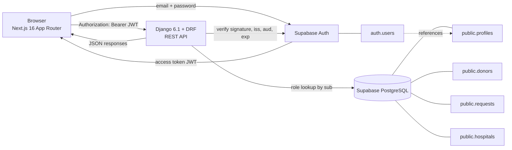
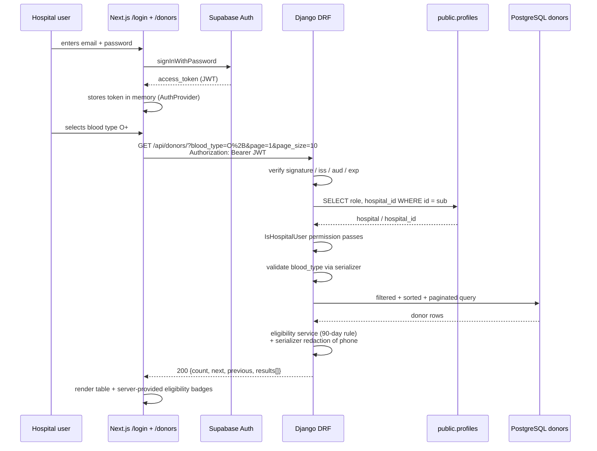

# Architecture

## 1. System architecture



## 2. Database relationship diagram

```mermaid
erDiagram
    AUTH_USERS ||--o| PROFILES : "id (FK, ON DELETE CASCADE)"
    HOSPITALS  ||--o{ PROFILES : "hospital_id (FK, SET NULL)"
    HOSPITALS  ||--o{ REQUESTS  : "hospital_id (FK, CASCADE)"
    PROFILES   ||--o{ REQUESTS  : "requester_profile_id (FK, SET NULL)"

    AUTH_USERS {
        uuid id PK
        text email
    }
    HOSPITALS {
        uuid id PK
        varchar name
        varchar location
        varchar phone
        timestamptz created_at
    }
    PROFILES {
        uuid id PK_FK
        varchar full_name
        varchar role "admin | hospital"
        uuid hospital_id FK
        timestamptz created_at
    }
    DONORS {
        uuid id PK
        varchar name
        varchar blood_type "8 allowed values"
        date last_donation "NULL = no history"
        varchar phone
        timestamptz created_at
        timestamptz updated_at
    }
    REQUESTS {
        uuid id PK
        uuid hospital_id FK
        varchar blood_type
        int units "CHECK > 0"
        varchar status "pending | fulfilled | cancelled"
        uuid requester_profile_id FK
        timestamptz created_at
        timestamptz updated_at
    }
```

`donors` has no foreign key by design: donor records are registry entries, not children
of a hospital or user account.

## 3. Trust boundaries

1. **Browser → Supabase Auth.** Only the public anon key is shipped to the browser.
2. **Browser → Django.** Every protected call carries an `Authorization: Bearer` header.
3. **Django → JWT verification.** Signature, algorithm allow-list (`HS256`, `RS256`,
   `ES256`), `iss`, `aud`, `exp` and required claims are verified. Unsigned `none`
   tokens are rejected.
4. **Django → profiles.** The verified `sub` is used to look up the application role in
   `public.profiles`. JWT role claims are never trusted for authorisation.
5. **Django → Postgres.** ORM queries use the configured `DATABASE_URL`; DRF permissions
   scope hospital users to their own `hospital_id`.
6. **PostgREST → Postgres.** RLS policies provide an independent second layer of access
   control for direct Supabase client access.

## 4. Complete request trace: hospital searches donors



### Failure paths

| Stage | Failure | Status | Response body |
|---|---|---|---|
| JWT missing or invalid | signature/exp/issuer/audience check fails | **401** | `{"error": {"code": "authentication_failed", "message": "..."}}` |
| Profile missing | verified user has no profile row | **403** | `{"error": {"code": "no_profile", "message": "..."}}` |
| Wrong role | e.g. hospital calls admin-only endpoint | **403** | `{"error": {"code": "permission_denied", "message": "..."}}` |
| Bad filter | `blood_type=XX` | **400** | field-level validation error |
| Business rule | ineligible donor selected for a request | **400** | includes `days_until_eligible` |
| Record missing | unknown donor id | **404** | `{"error": {"code": "not_found", "message": "..."}}` |

## 5. Eligibility rule (server-owned)

```text
last_donation IS NULL            -> eligible = true,  badge = no_history
days_since >= 90                 -> eligible = true,  badge = eligible
days_since <  90                 -> eligible = false, badge = ineligible
days_until_eligible = max(0, 90 - days_since)
```

The browser never computes this. It displays `eligible`, `days_until_eligible` and
`eligibility_badge` exactly as returned by Django. The rule is an application screening
requirement, not a clinical eligibility assessment.

## 6. Database changes vs. application changes

- Schema changes are made in `supabase/migrations/*.sql` — never by Django migrations.
- Django models for domain tables use `managed = False`.
- Django's own tables (`django_migrations`, `django_session`, etc.) stay in `public`
  with default names; Supabase's `auth` schema is separate, so there is no collision.
